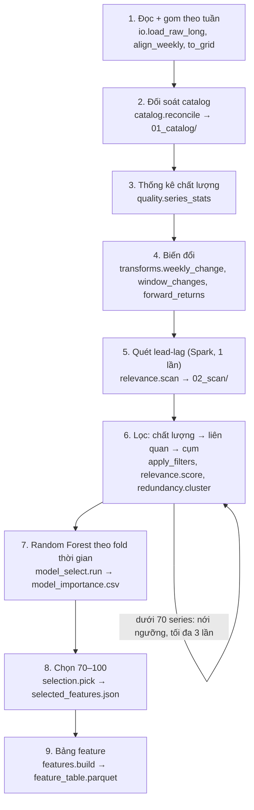
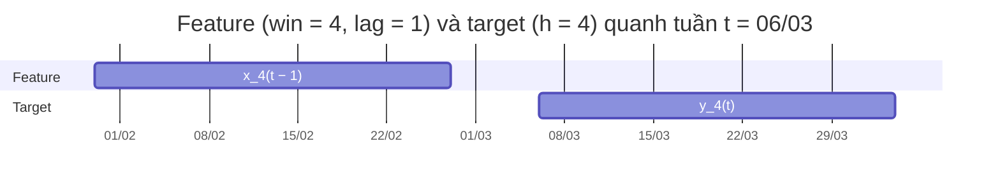
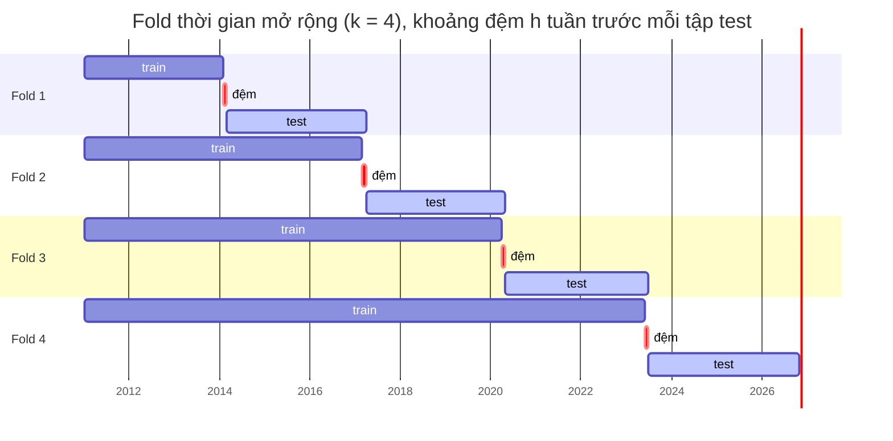

# Methodology: Pipeline chọn feature cho giá Than & Quặng sắt

Pipeline chọn 70–100 series (mặc định 85) trong hơn 800 series thị trường theo tuần. Series được chọn phải thỏa ba điều: thay đổi của nó **đi trước** thay đổi giá than và quặng sắt, mối quan hệ đó ổn định theo thời gian, và nó không trùng thông tin với các series khác đã chọn.

- Code: `src/fe_pipeline/` (PySpark)
- Tham số: `config/pipeline.yaml`
- Cách chạy: [README.md](../README.md)

## Mục lục

1. [Tổng quan](#1-tổng-quan)
2. [Dữ liệu đầu vào và chuẩn hóa thời gian](#2-dữ-liệu-đầu-vào-và-chuẩn-hóa-thời-gian)
3. [Đối soát catalog](#3-đối-soát-catalog)
4. [Kiểm soát chất lượng](#4-kiểm-soát-chất-lượng)
5. [Biến đổi chuỗi và định nghĩa target](#5-biến-đổi-chuỗi-và-định-nghĩa-target)
6. [Đo mức liên quan lead-lag](#6-đo-mức-liên-quan-lead-lag)
7. [Loại trùng lặp](#7-loại-trùng-lặp)
8. [Đánh giá đa biến bằng Random Forest](#8-đánh-giá-đa-biến-bằng-random-forest)
9. [Chọn cuối](#9-chọn-cuối)
10. [Output](#10-output)
11. [Tham số và cách tinh chỉnh](#11-tham-số-và-cách-tinh-chỉnh)
12. [Giới hạn của phương pháp](#12-giới-hạn-của-phương-pháp)
13. [Bảng chú thích function](#13-bảng-chú-thích-function)

---

## 1. Tổng quan

**Bài toán.** Pipeline có 4 target:

- than nhiệt Newcastle (`XAL1:COM`)
- than cốc (`DJM:COM`)
- quặng sắt 62% (`SCO:COM`)
- quặng sắt DCE (`IOE:COM`)

Mỗi target xét 2 horizon (h = 1 tuần và 4 tuần), nên có tổng cộng **8 task**. Một task là: dự đoán log-return của một target từ tuần t đến tuần t+h, chỉ dùng thông tin có được đến tuần t.

**Năm nguyên tắc thiết kế:**

1. **Làm việc trên thay đổi, không trên mức giá.** Hai mức giá cùng có xu hướng tăng sẽ tương quan cao dù không liên quan gì nhau (tương quan giả). Thay đổi theo tuần không bị vấn đề này.
2. **Không nhìn tương lai.** Feature luôn kết thúc tại hoặc trước tuần t, còn target luôn bắt đầu từ tuần t. Giữa train và test của model có khoảng đệm.
3. **Ngưỡng tính từ chính dữ liệu.** Ngưỡng "đủ liên quan" được đo trên target bị xáo trộn thời điểm, nên tự thích nghi với độ dài và độ nhiễu của dữ liệu thật.
4. **Đa dạng thông tin.** Pipeline loại series trùng nhau bằng gom cụm, phạt series tương quan với series đã chọn, và giới hạn số slot cho mỗi group.
5. **Truy vết được.** Mỗi series có một dòng trong `selection_report.csv`, ghi rõ nó bị loại ở bước nào và vì sao.

**Phân vai Spark và pandas.**

- **Spark** làm các bước nặng: đọc dữ liệu, chuẩn hóa lưới tuần, biến đổi, quét lead-lag (hàng chục triệu dòng), Random Forest, và bảng feature.
- **Pandas** (trên driver) làm các bước trên bảng nhỏ: thống kê từng series, chấm điểm, ma trận tương quan vài trăm × vài trăm, và bước chọn cuối.



---

## 2. Dữ liệu đầu vào và chuẩn hóa thời gian

**Đọc dữ liệu** (`io.load_raw_long`):

- Nhận CSV, Parquet, hoặc một thư mục chứa một trong hai loại.
- Tự nhận dạng: dữ liệu là **long** nếu có cả cột `series_col` và `value_col` và không quá 5 cột; ngược lại là **wide** (mỗi series một cột).
- Dữ liệu wide được xoay thành long bằng `stack` của Spark. Từ đây trở đi, mọi bước làm việc trên một dạng duy nhất: `(date, series, value)`, trong đó `series` là tên cột gốc.

**Chuẩn hóa ngày** (`io._to_date`):

- Cột ngày kiểu date, timestamp hoặc chuỗi được dùng nguyên.
- Cột ngày kiểu số được hiểu là epoch, và đơn vị (giây, ms, µs hay ns) được đoán theo độ lớn của số.
- Lý do: Parquet do pandas ghi lưu timestamp ở độ chính xác nano giây, và Spark 3.x không đọc được kiểu này. Session được cấu hình `spark.sql.legacy.parquet.nanosAsLong=true` để đọc nó thành số nguyên, rồi bước này đổi lại về ngày.

**Làm sạch giá trị:** NaN và ±inf được đổi thành null. Lý do: trong Spark, NaN không phải null, và chỉ một giá trị NaN cũng làm `corr()` trả về NaN.

**Chốt về cuối tuần** (`io.align_weekly`). Mỗi quan sát được gắn vào thứ Sáu đầu tiên **vào hoặc sau** ngày của nó:

```
week = next_day(date − 1 ngày, 'Fri')
```

Trong mỗi tuần chỉ giữ quan sát có ngày muộn nhất. Cách này xử lý được dữ liệu theo ngày, dữ liệu tuần ghi vào thứ khác, và các dòng bị trùng. Vì quan sát chỉ được đẩy về sau, không bao giờ về trước, nên bước này không gây rò rỉ thông tin.

**Lưới tuần đầy đủ** (`io.to_grid`):

- Tạo lưới mọi thứ Sáu từ ngày đầu đến ngày cuối của toàn bộ dữ liệu.
- Mỗi series chỉ có dòng kể từ quan sát đầu tiên của nó, nên series bắt đầu muộn không bị tính là "thiếu" ở giai đoạn trước khi nó tồn tại.
- Khoảng trống được lấp bằng giá trị gần nhất trước đó (forward-fill), nhưng tối đa `max_ffill_weeks` = 4 tuần. Khoảng trống dài hơn vẫn để null.
- Cài đặt: `last(value, ignorenulls)` trên cửa sổ 5 dòng gần nhất.

**Cột rỗng:** cột không có giá trị nào bị loại và được liệt kê trong `run_summary.json → empty_series`.

---

## 3. Đối soát catalog

Mục tiêu: gán mỗi cột dữ liệu vào đúng **một** mục trong catalog (gồm symbol, asset class và group).

- Mục có trong catalog nhưng không có trong data là **thừa**: bị loại khỏi catalog đã đối soát.
- Cột có trong data nhưng không có trong catalog là **thiếu**: được đưa vào group `_UNASSIGNED` và vẫn được xét chọn như mọi feature khác.

Code: `catalog.reconcile`, class `Matcher`.

**Định dạng catalog nhận được:**

- dạng chi tiết: mỗi series một object;
- dạng group: các trường `asset_class`, `group`, `members`. Đây cũng là dạng của file sửa tay.

Nếu phần tử có trường `column` (có trong catalog đã đối soát), pipeline khớp thẳng theo tên cột.

**Chuẩn hóa trước khi so:**

- `norm_text`: bỏ dấu, chữ thường, `&` thành `and`, mọi ký tự không phải chữ/số thành dấu cách.
- `norm_symbol`: chữ hoa và chỉ giữ chữ/số. Ví dụ `sco_com`, `SCO:COM` và `SCO COM` đều thành `SCOCOM`.

**Thứ tự khớp.** Pipeline thử lần lượt và dừng ở bước đầu tiên tìm được ứng viên:

| Bước | Cách khớp | Ví dụ |
| --- | --- | --- |
| 1 | Alias khai báo tay trong `config/aliases.yaml` | `iron_ore_62fe` → SCO:COM |
| 2 | Tên cột đã ghi trong catalog đã đối soát | `Coal` → Coal |
| 3 | Symbol (sau `norm_symbol`) | `sco_com` → SCO:COM |
| 4 | Tên chính xác (sau `norm_text`) | `Iron Ore` → Iron Ore |
| 5 | Tên sau khi bỏ từ gợi ý loại tài sản (`10y`, `bond`, `yield`, `spot`, `futures`, `electricity`, …) | `Germany 10Y` → `germany` |
| 6 | Slug trong URL Trading Economics | `crude-oil` → Crude Oil |
| 7 | Fuzzy (`difflib` ≥ 0.92, hoặc tên catalog nhiều từ nằm trọn trong tên cột) — **chỉ gợi ý**, không tự áp dụng trừ khi `allow_fuzzy: true` | `Natural Gas Henry Hub` → gợi ý Natural gas |

**Khử mơ hồ** (`Matcher._disambiguate`). Khi nhiều mục trong catalog cùng khớp, pipeline lọc theo từ gợi ý trong tên cột:

- có `electricity` → chỉ giữ group Electricity;
- có `10y` / `bond` → chỉ giữ asset class bond;
- …

Nếu sau khi lọc vẫn còn nhiều hơn một ứng viên, cột được đánh dấu `ambiguous` và đưa vào `_UNASSIGNED`, thay vì đoán.

**Target** (`catalog.resolve_targets`). Mỗi target được tìm qua `targets.<tên>.column` nếu có, nếu không thì qua symbol trong catalog.

- Target bắt buộc (`targets.required`) không tìm thấy → pipeline dừng với thông báo lỗi rõ ràng.
- Target phụ không tìm thấy → bị bỏ qua, kèm cảnh báo.

---

## 4. Kiểm soát chất lượng

Thống kê được tính trên lưới tuần, sau khi đã lấp khoảng trống (`quality.series_stats`, chạy trên Spark). Lọc diễn ra trên pandas (`quality.apply_filters`).

| Chỉ số | Định nghĩa | Ngưỡng loại (relax = 1) |
| --- | --- | --- |
| `n_obs` | Số tuần có giá trị | < 260 (5 năm) |
| `missing_ratio` | 1 − n_obs / số tuần từ giá trị đầu đến cuối dữ liệu | > 0.20 |
| `stale_weeks` | (ngày cuối của dữ liệu − ngày giá trị cuối của series) / 7 | > 12 (series đã ngừng cập nhật) |
| `zero_change_ratio` | Tỷ lệ tuần có thay đổi = 0 | > 0.50 (tỷ giá neo, series kém thanh khoản) |
| `n_jumps` | Số tuần có \|log-return\| > 1.0 | Không loại, chỉ đánh dấu `possible_unit_break` |

Khi nới ngưỡng với hệ số `relax` (xem [mục 9](#9-chọn-cuối)):

- `min_history` chia cho `relax`;
- `max_missing` nhân `relax`, tối đa 0.6;
- `max_stale` nhân `relax`;
- `max_zero_change` nhân `relax`, tối đa 0.9.

Ngoài ra, series có dưới 104 tuần dữ liệu không bao giờ được quét lead-lag, kể cả khi đã nới ngưỡng, vì quá ngắn để ước lượng tương quan.

---

## 5. Biến đổi chuỗi và định nghĩa target

**Chọn phép biến đổi** (`transforms.choose_methods`, cấu hình ở `transform.by_asset_class`):

| Loại | Phép biến đổi d1 (thay đổi 1 tuần) |
| --- | --- |
| commodity, stock_index, share, currency | log-return: ln(P_t / P_{t−1}) |
| bond | hiệu số: y_t − y_{t−1} (điểm %) |
| Series có giá trị ≤ 0 (ví dụ dầu WTI tháng 4/2020) | tự chuyển sang hiệu số |

**Winsorize** (`transforms.weekly_change`). Với mỗi series, giá trị d1 được cắt về khoảng:

$$
\text{median} \pm k \cdot 1.4826 \cdot \text{MAD}, \qquad k = 8
$$

trong đó MAD = trung vị của |d1 − median|, và hệ số 1.4826 đưa MAD về cùng thang với độ lệch chuẩn.

- Bước này chặn ảnh hưởng của các bước nhảy do đổi đơn vị hoặc lỗi dữ liệu.
- d1 bị null vẫn giữ null. Đây là chỗ cần chú ý: `greatest`/`least` của Spark bỏ qua null, nên nếu không xử lý riêng, null sẽ bị thay thành ngưỡng cắt.
- Series có MAD = 0 không bị cắt.

**Thay đổi theo cửa sổ** (`transforms.window_changes`):

$$
x_{\text{win}}(t) = \sum_{i=0}^{\text{win}-1} d1(t-i), \qquad \text{win} \in \{1, 4\}
$$

Chỉ tính khi đủ `win` giá trị không null.

**Target** (`transforms.forward_returns`):

$$
y_{T,h}(t) = \ln\frac{P_T(t+h)}{P_T(t)}
$$

Target dùng giá trên lưới tuần (đã lấp khoảng trống) và **không** winsorize. Target có giá trị ≤ 0 thì dùng hiệu số.

**Căn thời gian (chống rò rỉ).** Feature ở độ trễ `lag` là thay đổi kết thúc tại tuần t − lag, còn target là lợi suất từ t đến t+h. Với lag = 0, feature kết thúc đúng lúc target bắt đầu, nên vẫn hợp lệ.



> Rủi ro về giờ chốt giá: thị trường đóng cửa lệch giờ nhau. Ví dụ chứng khoán Mỹ đóng cửa thứ Sáu sau giá quặng châu Á. Khi đó feature ở lag 0 có thể chứa thông tin xảy ra sau giá target tuần t. Nếu nguồn dữ liệu không đồng bộ giờ chốt, đặt `transform.min_lag: 1`.

---

## 6. Đo mức liên quan lead-lag

### 6.1 Quét (Spark, chạy một lần)

Code: `relevance.scan`. Với mỗi cặp (series, cửa sổ `win`, độ trễ `lag` từ 0 đến 8, task):

$$
\rho = \operatorname{corr}\big(\operatorname{rank}(x_{\text{win}}(t-\text{lag})),\ \operatorname{rank}(y_{T,h}(t))\big)
$$

- Hạng được tính bằng `percent_rank` trên toàn mẫu của từng series. Hệ số Pearson trên hạng gần bằng Spearman, và chịu được đuôi dày của lợi suất.
- Cài đặt: dữ liệu feature được nhân bản theo 9 độ trễ (dời ngày đi `7·lag`), rồi join với bảng target (8 task, broadcast). Sau đó `groupBy(series, win, lag).agg(corr)`. Khoảng 800 series × 2 cửa sổ × 9 độ trễ × 826 tuần ≈ 12 triệu dòng.
- Song song, pipeline tính cùng tương quan đó trên **4 giai đoạn liên tiếp** của dữ liệu (`n_periods`), dùng để kiểm tra độ ổn định.

Kết quả quét được lưu vào `02_scan/`, nên khi chỉnh ngưỡng không cần quét lại.

### 6.2 Ngưỡng null bằng dịch vòng

Mỗi series được thử 18 biến thể (2 cửa sổ × 9 độ trễ), và pipeline lấy biến thể tốt nhất. Chỉ riêng việc chọn biến thể tốt nhất đã làm |ρ| cao lên dù không có quan hệ thật: với khoảng 800 tuần, con số đó vào khoảng 0.08–0.12.

Để biết thế nào là "cao hơn ngẫu nhiên", pipeline tạo một **target null** cho mỗi task (`relevance._null_shift`). Target null là target thật bị dịch vòng đi một khoảng ngẫu nhiên, nằm trong khoảng [max(52, n/4), n − max(52, n/4)) tuần.

- Phép dịch giữ nguyên phân phối và tự tương quan của target, nhưng phá vỡ mọi quan hệ thời điểm với feature.
- Pipeline quét y hệt trên target null, rồi lấy ngưỡng:

$$
\text{thr}_{\text{task}} = \max\Big(Q_{q}\big(\max_{\text{win},\,\text{lag}} |\rho^{\text{null}}|\big),\ \text{min\_abs\_spearman}\Big), \qquad q = 0.95
$$

Ở đây Q_q là phân vị q tính qua tất cả series. Trên dữ liệu giả lập, ngưỡng này ra khoảng 0.11 cho horizon 1 tuần và 0.14–0.17 cho horizon 4 tuần.

### 6.3 Điểm và điều kiện qua lọc

Code: `relevance.score`. Với mỗi series và mỗi task:

1. **Biến thể tốt nhất:** (win, lag) có |ρ| lớn nhất.
2. **Độ ổn định** `cons`: tỷ lệ giai đoạn mà ρ của biến thể đó có cùng dấu với ρ toàn mẫu.
3. **Qua task:** |ρ| ≥ thr_task **và** cons ≥ 0.75.
4. **Điểm task:** hạng phần trăm của |ρ| · cons, tính trong tất cả series.

Gộp các task lại:

$$
\text{relevance\_score} = \tfrac12 \max_{\text{task}} \text{score}_{\text{task}} + \tfrac12 \operatorname{mean}_{\text{task}} \text{score}_{\text{task}}
$$

Phần `max` thưởng series rất mạnh ở một task. Phần `mean` thưởng series hữu ích ở nhiều task. Điểm theo từng target, `target_score__<target>`, dùng cùng công thức nhưng chỉ gộp các horizon của target đó.

**Ứng viên** cho bước sau là hợp, qua mọi task, của top `keep_top_per_target` = 100 series qua task đó (xếp theo điểm task). Danh sách bắt buộc (`must_include_symbols`) và các target luôn được thêm vào.

> Vì sao cap là 100 chứ không 40: trên dữ liệu giả lập, khoảng 150 series là "proxy" (tương quan với driver thật) có |ρ| ≈ 0.2. Với cap 40, chúng chiếm hết top 40 của mọi task và đẩy driver thật ra ngoài, dù driver thật đã vượt ngưỡng null.

---

## 7. Loại trùng lặp

Code: `redundancy.candidate_corr` và `redundancy.cluster`.

**Ma trận tương quan:**

1. Xoay d1 (thay đổi 1 tuần) của các series quét được thành dạng wide bằng Spark.
2. Đưa về driver và tính tương quan Pearson theo cặp, yêu cầu ít nhất 104 tuần trùng nhau.
3. Cặp không đủ dữ liệu trùng được coi là không liên quan (corr = 0).

**Vì sao dùng correlation thay vì covariance:** covariance phụ thuộc đơn vị và độ biến động của từng series (lợi suất trái phiếu tính bằng điểm %, tỷ giá dao động khoảng 0.7%/tuần, HRC khoảng 3%/tuần), nên không đặt được một ngưỡng chung. Correlation là covariance đã chuẩn hóa:

$$
\operatorname{corr}(X,Y) = \frac{\operatorname{cov}(X,Y)}{\sigma_X\,\sigma_Y}
$$

**Gom cụm phân cấp:**

- Khoảng cách giữa hai series là 1 − |corr|. Dấu không quan trọng: hai series ngược chiều hoàn toàn vẫn chứa cùng một thông tin.
- Dùng liên kết trung bình (average linkage), cắt cây tại khoảng cách 1 − 0.85, tức là các series có |corr| trung bình > 0.85 vào chung cụm.

**Đại diện của cụm:**

- Nếu cụm có series bắt buộc, series đó là đại diện. Các series bắt buộc khác trong cùng cụm cũng được giữ.
- Nếu không, đại diện là series có `relevance_score` cao nhất.

Ví dụ trên dữ liệu giả lập: "HRC Steel (vendor B)" (tương quan 0.99 với HRC Steel) bị gộp vào cụm của HRC Steel.

Bước này chỉ bắt được trùng lặp **rất cao**. Các nhóm thay thế ở mức 0.6–0.85 được xử lý bằng hình phạt mRMR ở [mục 9](#9-chọn-cuối).

---

## 8. Đánh giá đa biến bằng Random Forest

Code: `model_select.run` và `_fit_task`. Bước này trả lời câu hỏi: khi đưa tất cả đại diện vào cùng một model, series nào thật sự được model dùng?

**Ma trận đầu vào cho mỗi task** (`_design`):

- Mỗi đại diện vào model bằng biến thể (win, lag) tốt nhất **của chính task đó**.
- Giá trị thiếu được điền 0, tức là "không thay đổi".
- Tên cột được đổi thành `f0`, `f1`, … vì tên series có thể chứa `.` hoặc `:`, mà Spark sẽ hiểu sai.

**Fold thời gian mở rộng có khoảng đệm.** Chia các ngày thành k + 1 khối bằng nhau (mặc định k = 4). Ở fold i:

- **train:** mọi ngày trước mốc cắt thứ i, trừ đi h tuần đệm. Khoảng đệm này cần thiết vì target h tuần của tuần cuối tập train chồng lên đầu tập test.
- **test:** khối tiếp theo.



**Model:** `RandomForestRegressor` của Spark ML với 100 cây, độ sâu 5, mỗi lần tách xét 1/3 số feature. Có thể đổi sang GBT qua `model.algorithm`.

**Điểm model:**

- importance của mỗi feature được lấy trung bình qua các fold;
- đổi thành hạng phần trăm trong từng task;
- gộp các task: `model_score = ½·max + ½·mean`.

**Kiểm tra tín hiệu:** rank-IC ngoài mẫu, tức Spearman giữa dự báo và thực tế trên tập test, cho từng fold. Kết quả nằm ở `run_summary.json → model_metrics`. Nếu IC quanh 0 thì tập feature không mang tín hiệu cho task đó.

**Song song:** 8 task được fit từ một thread pool (`model.parallel_tasks` = 2), Spark xếp các job này chạy cạnh nhau. Mỗi task giữ dữ liệu train riêng trong bộ nhớ: với 4 thread và driver 4 GB thì từng bị hết bộ nhớ.

**Điểm tổng hợp:**

$$
\text{combined} = (1-w)\cdot\operatorname{pctrank}(\text{relevance\_score}) + w\cdot\text{model\_score}, \qquad w = 0.4
$$

---

## 9. Chọn cuối

Code: `selection.pick`. Pipeline chọn k = `k_target` = 85 series từ tập đại diện, qua ba vòng:

1. **Danh sách bắt buộc:** các symbol trong `must_include_symbols` (quặng, than, HRC, thép, phế liệu, cước container, USDCNY, AUDUSD, USDBRL) cộng với cả 4 target, nếu chúng qua được lọc chất lượng. Vòng này không bị giới hạn bởi trần group.
2. **Quota theo target:** với từng target, chọn thêm tối đa `min_per_target` = 12 series, xếp theo `target_score__<target>`. Nhờ vậy target có driver yếu hơn (như than Newcastle) không bị target khác lấn át slot.
3. **Lấp đầy:** chọn theo `combined_score` cho đến đủ k series.

Ở vòng 2 và 3, mỗi lần chọn là **tham lam kiểu mRMR** (maximum relevance, minimum redundancy). Series tiếp theo được chọn là series có điểm điều chỉnh cao nhất:

$$
\text{adj}(s) = \text{score}(s) - \lambda \cdot \max_{c \in \text{đã chọn}} |\operatorname{corr}(s, c)|, \qquad \lambda = 0.5
$$

Ví dụ: một chỉ số chứng khoán tương quan 0.75 với chỉ số đã chọn bị trừ 0.375 điểm. Vì thế slot không bị lấp bởi một nhóm series thay thế gần nhau.

**Trần group:** mỗi `asset_class/group` có tối đa ⌈0.20 × 85⌉ = 17 series (danh sách bắt buộc không tính vào trần).

### Vòng nới ngưỡng

Các bước 6–7 trong sơ đồ (lọc chất lượng → liên quan → gom cụm) chạy trong một vòng lặp tối đa 4 lần (`step` = 0..3), với hệ số:

```
relax = 1 + 0.5 · step
```

Vòng lặp dừng ngay khi số đại diện ≥ `k_min` = 70. Tất cả chỉ tính lại trên pandas từ kết quả quét đã lưu, không quét lại.

| step | relax | Phân vị null | Yêu cầu cùng dấu | Ngưỡng cụm | Lịch sử tối thiểu |
| --- | --- | --- | --- | --- | --- |
| 0 | 1.0 | 0.95 | 0.75 | 0.85 | 260 tuần |
| 1 | 1.5 | 0.90 | 0.65 | 0.88 | 173 tuần |
| 2 | 2.0 | 0.85 | 0.55 | 0.91 | 130 tuần |
| 3 | 2.5 | 0.80 | 0.50 | 0.94 | 104 tuần |

Nếu sau step 3 vẫn dưới 70, pipeline bù bằng các series qua lọc chất lượng có `relevance_score` cao nhất mà không tương quan quá ngưỡng cụm với series đã có. Các series này được gắn nhãn `low_evidence_fill` và có cảnh báo trong `run_summary.json`.

---

## 10. Output

Bảng feature (`features.build`): với mỗi series được chọn, tạo các cột sau từ d1:

| Cột | Ý nghĩa |
| --- | --- |
| `<series>_d1_lag0/1/2/4` | Thay đổi 1 tuần tại t, t−1, t−2, t−4 |
| `<series>_mom4`, `<series>_mom13` | Trung bình d1 trong 4 và 13 tuần gần nhất (momentum) |
| `y__<target>__h<h>` | Target của từng task |

Tên cột được chuẩn hóa (chữ thường, ký tự lạ thành `_`) bằng `features.safe_name`.

| File | Nội dung |
| --- | --- |
| `selected_features.json` | Danh sách chọn theo group, kèm chi tiết từng feature: biến thể tốt nhất mỗi task (rho, lag, win), lý do chọn, điểm |
| `feature_table.parquet` | Bảng feature ở trên, sẵn sàng đưa vào model |
| `selection_report.csv` | Mọi series kèm `drop_stage`: `quality`, `relevance`, `redundancy`, `selection(rank/group cap)` hoặc `selected`; có thêm thống kê chất lượng, rho/lag/win/cons theo task, cụm, điểm |
| `run_summary.json` | Funnel số lượng qua từng tầng, bước nới ngưỡng đã dùng, ngưỡng null thực tế, rank-IC ngoài mẫu, cảnh báo, thời gian chạy |
| `model_importance.csv` | Importance của Random Forest theo từng task |
| `01_catalog/` | `catalog_reconciled.json`, `column_mapping.json`, `catalog_report.json` |
| `02_scan/` | Kết quả quét lead-lag thô và thống kê từng series |

---

## 11. Tham số và cách tinh chỉnh

| Tham số | Mặc định | Tăng thì | Giảm thì |
| --- | --- | --- | --- |
| `targets.horizons` | [1, 4] | Thêm task dài hạn, chạy lâu hơn | — |
| `quality.min_history_weeks` | 260 | Bỏ nhiều series mới niêm yết | Giữ series ngắn, ước lượng nhiễu hơn |
| `quality.max_ffill_weeks` | 4 | Lấp khoảng trống dài hơn, có rủi ro tạo dữ liệu giả | Nhiều null hơn |
| `transform.max_lag` | 8 | Tìm quan hệ trễ dài hơn, ngưỡng null tăng theo | Ngược lại |
| `transform.min_lag` | 0 | Đặt 1 khi giờ chốt giá không đồng bộ | — |
| `relevance.n_periods` | 4 | Kiểm tra ổn định khắt khe hơn, mỗi giai đoạn ngắn hơn | Lỏng hơn |
| `relevance.min_sign_consistency` | 0.75 | Ít ứng viên hơn, ổn định hơn | Nhiều ứng viên hơn |
| `relevance.keep_top_per_target` | 100 | Nhiều ứng viên hơn, Random Forest chậm hơn | Proxy dễ lấn át driver thật |
| `redundancy.corr_threshold` | 0.85 | Gom ít hơn | Gom mạnh tay hơn |
| `model.weight` | 0.4 | Tin model nhiều hơn tương quan đơn biến | Ngược lại |
| `model.parallel_tasks` | 2 | Nhanh hơn, tốn bộ nhớ hơn | Chậm hơn, an toàn bộ nhớ |
| `selection.k_target` | 85 | Thêm feature | Bớt feature (giữ trong khoảng 70–100) |
| `selection.min_per_target` | 12 | Chia đều cho các target hơn | Ưu tiên điểm chung hơn |
| `selection.max_share_per_group` | 0.20 | Cho phép một group chiếm nhiều slot hơn | Ép đa dạng group hơn |
| `selection.redundancy_penalty` | 0.5 | Ưu tiên đa dạng | Ưu tiên điểm cao |

Mọi tham số có thể truyền tạm trên dòng lệnh, ví dụ:

```
--set selection.k_target=90 --set transform.min_lag=1
```

---

## 12. Giới hạn của phương pháp

1. **Chọn feature trên toàn bộ lịch sử.** Pipeline nhìn cả giai đoạn mà sau này sẽ làm tập test của model cuối. Khi đánh giá model, hãy chạy lại pipeline với `input.end_date` đặt tại điểm cắt train/test.
2. **Đa cộng tuyến ngoài từng cặp.** Tương quan theo cặp không bắt được trường hợp một feature là tổ hợp tuyến tính của vài feature khác. Ví dụ: Iron Ore CNY ≈ Iron Ore + USDCNY, cho VIF 88–90 trên dữ liệu giả lập. Với model tuyến tính, nên kiểm tra VIF hoặc bỏ bớt một feature trong nhóm đó.
3. **Lọc đơn biến trước.** Series chỉ có tác dụng khi kết hợp với series khác có thể bị loại trước khi đến Random Forest.
4. **Spearman xấp xỉ.** Hạng được tính trên toàn mẫu của từng series, không phải trên từng cặp quan sát. Sai lệch nhỏ với series có nhiều khoảng trống.
5. **Điền 0 trong Random Forest.** Series bắt đầu muộn bị đánh giá thấp hơn một chút.
6. **Độ nhạy có giới hạn.** Driver thật có |ρ| dưới ngưỡng null (khoảng 0.11 với 800 tuần) về mặt thống kê không phân biệt được với ngẫu nhiên. Trên dữ liệu giả lập, đây là lý do bỏ sót USDINR (ρ = −0.08).
7. **Catalog chưa đủ.** Danh sách cổ phiếu theo nước mới có 12 nước. Cổ phiếu các nước khác rơi vào `_UNASSIGNED`, nhưng vẫn được xét chọn.

---

## 13. Bảng chú thích function

### `src/fe_pipeline/` — pipeline chính

| Module | Function | Làm gì | Đầu vào → Đầu ra |
| --- | --- | --- | --- |
| `config` | `load` | Đọc YAML config và áp các override dạng `a.b.c=giá_trị` từ dòng lệnh | đường dẫn yaml, list override → dict config |
| `spark_utils` | `get_spark` | Dùng lại SparkSession đang có (cluster/Databricks) hoặc tạo session local; kiểm tra Java; bật cấu hình đọc timestamp nano | config → SparkSession |
| `io` | `_read_any` | Đọc CSV (có header, tự suy kiểu) hoặc Parquet, file hoặc thư mục | đường dẫn → DataFrame thô |
| `io` | `_to_date` | Đổi cột ngày về kiểu date; số nguyên được hiểu là epoch, đơn vị đoán theo độ lớn | DataFrame, tên cột → biểu thức cột date |
| `io` | `_detect_format` | Quyết định dữ liệu là long hay wide (khi `format: auto`) | DataFrame, config input → `"long"` / `"wide"` |
| `io` | `wide_to_long` | Xoay bảng wide thành long bằng `stack` | DataFrame wide → (date, series, value) |
| `io` | `load_raw_long` | Đọc + nhận dạng + xoay + chuẩn hóa ngày + lọc khoảng ngày + NaN/inf thành null | Spark, config → (long DataFrame, danh sách cột khai báo hoặc None) |
| `io` | `align_weekly` | Gắn mỗi quan sát vào thứ Sáu cùng tuần, giữ quan sát muộn nhất trong tuần | long → long theo tuần |
| `io` | `to_grid` | Tạo lưới tuần đầy đủ từ ngày đầu của mỗi series; lấp khoảng trống tối đa N tuần | long theo tuần, N → lưới (date, series, value) |
| `io` | `long_to_wide` | Xoay long về wide (tiện ích) | long → wide |
| `catalog` | `norm_text` | Chuẩn hóa tên: bỏ dấu, chữ thường, chỉ giữ chữ/số | chuỗi → chuỗi |
| `catalog` | `norm_symbol` | Chuẩn hóa symbol: chữ hoa, bỏ ký tự phân cách | chuỗi → chuỗi |
| `catalog` | `strip_hints` | Bỏ các từ gợi ý loại tài sản (`10y`, `bond`, `spot`, …) khỏi tên | chuỗi → chuỗi |
| `catalog` | `hinted_classes` | Tìm các loại tài sản được gợi ý trong tên cột | tên cột → tập asset class |
| `catalog` | `load_catalog` | Đọc catalog dạng chi tiết hoặc dạng group thành danh sách mục thống nhất, mỗi mục có `entry_id` | đường dẫn json → list mục |
| `catalog` | `load_aliases` | Đọc `aliases.yaml` | đường dẫn → dict cột → symbol |
| `catalog` | `Matcher.__init__` | Dựng các chỉ mục tra cứu theo cột, symbol, tên, slug URL | list mục → Matcher |
| `catalog` | `Matcher._disambiguate` | Thu hẹp nhiều ứng viên bằng từ gợi ý trong tên cột | tên cột, ứng viên → ứng viên còn lại |
| `catalog` | `Matcher.match` | Khớp một cột theo thứ tự alias → cột → symbol → tên → tên bỏ gợi ý → slug | tên cột, aliases → `{status, method, entry/candidates}` |
| `catalog` | `Matcher.fuzzy` | Gợi ý gần đúng (difflib + tên catalog nằm trong tên cột) | tên cột, ngưỡng → list mục gợi ý |
| `catalog` | `reconcile` | Khớp mọi cột, ghi `catalog_reconciled.json`, `column_mapping.json`, `catalog_report.json` | list cột, config catalog, thư mục → `{mapping, report}` |
| `catalog` | `resolve_targets` | Tìm cột dữ liệu của từng target; dừng nếu thiếu target bắt buộc | config targets, mapping → `{targets, missing}` |
| `quality` | `series_stats` | Tính thống kê chất lượng mỗi series trên Spark | lưới, ngưỡng nhảy → DataFrame thống kê |
| `quality` | `apply_filters` | Áp ngưỡng (có hệ số relax), gắn `quality_pass`, `quality_reason`, `possible_unit_break` | pandas thống kê, config, relax → pandas đã gắn cờ |
| `transforms` | `choose_methods` | Chọn log-return / hiệu số / pct cho từng series theo asset class; series có giá trị ≤ 0 dùng hiệu số | mapping, thống kê, config → dict series → phép biến đổi |
| `transforms` | `weekly_change` | Tính d1 và winsorize theo median ± k·MAD từng series | lưới, phép biến đổi, k → (date, series, d1) |
| `transforms` | `window_changes` | Tổng d1 trên cửa sổ 1 và 4 tuần | d1, list cửa sổ → (date, series, win, x) |
| `transforms` | `forward_returns` | Lợi suất kỳ tới của target theo từng horizon | lưới, target, horizon → wide (date, y__target__hH) |
| `relevance` | `_null_shift` | Dịch vòng chuỗi target để tạo target null | Series, độ dịch → Series |
| `relevance` | `scan` | Quét tương quan hạng cho mọi (series, win, lag, task), trên toàn mẫu và theo giai đoạn; kèm target null | xwin, bảng target, lag, giai đoạn, seed → (overall, by_period, tasks) |
| `relevance` | `score` | Chọn biến thể tốt nhất, tính ngưỡng null, độ ổn định, điểm task/target/relevance, cờ qua lọc, tập ứng viên | kết quả quét, config, relax → pandas một dòng mỗi series |
| `redundancy` | `candidate_corr` | Ma trận tương quan Pearson theo cặp của d1 (pivot bằng Spark) | d1, danh sách series → ma trận pandas |
| `redundancy` | `cluster` | Gom cụm phân cấp theo 1 − \|corr\|, chọn đại diện mỗi cụm | ma trận corr, điểm, ngưỡng, series bắt buộc → bảng cụm |
| `model_select` | `_design` | Dựng ma trận feature cho một task: mỗi series lấy (win, lag) tốt nhất của task đó | xwin, kết quả relevance, đại diện, task → (wide DataFrame, cột) |
| `model_select` | `_fit_task` | Fit Random Forest trên các fold thời gian có khoảng đệm; trả importance trung bình và rank-IC ngoài mẫu | dữ liệu, task, config → (importance từng series, metric) |
| `model_select` | `run` | Chạy `_fit_task` song song cho các task, gộp thành `model_score` | đại diện, task, config → (model_score, importance, metrics) |
| `selection` | `pick` | Chọn k feature: bắt buộc → quota theo target → lấp theo điểm tổng hợp | pool, config, target, bắt buộc, corr → pool có `selected`, `selected_by`, `selection_order` |
| `selection` | `pick.take` (nội bộ) | Thêm một series nếu chưa đủ k và group chưa chạm trần | series, lý do → True/False |
| `selection` | `pick.greedy` (nội bộ) | Chọn tham lam theo điểm − λ·max\|corr\| với series đã chọn | điểm, số cần lấy, lý do → (cập nhật danh sách chọn) |
| `features` | `safe_name` | Chuẩn hóa tên cột output | chuỗi → chuỗi |
| `features` | `build` | Tạo bảng feature: lag 0/1/2/4 và momentum 4/13 tuần của series đã chọn, kèm target | d1, target, series đã chọn, config → wide DataFrame |
| `pipeline` | `_log` | In log có giờ | chuỗi → (in ra) |
| `pipeline` | `run` | Điều phối toàn bộ 9 bước, vòng nới ngưỡng, ghi mọi report | config → dict tóm tắt (`run_summary.json`) |

### `scripts/` — điểm chạy và công cụ phụ

| Script | Function | Làm gì |
| --- | --- | --- |
| `run_pipeline.py` | `__main__` | Đọc config + `--set`, gọi `pipeline.run` |
| `reconcile_catalog.py` | `__main__` | Chỉ đối soát catalog (bỏ qua cột rỗng), in tóm tắt thừa/thiếu/mơ hồ và target tìm được |
| `make_synthetic_data.py` | `ar1` | Sinh nhân tố AR(1) với nhiễu Student-t (đuôi dày) |
| `make_synthetic_data.py` | `regime_vol` | Hệ số biến động theo giai đoạn khủng hoảng (2015, 2020, 2022) |
| `make_synthetic_data.py` | `loadings` | Hệ số tải nhân tố của một series theo asset class, group và nước |
| `make_synthetic_data.py` | `main` | Sinh khoảng 880 series, target có driver thật, cài lỗi dữ liệu, ghi các biến thể wide/long/CSV và `ground_truth.json` |
| `make_synthetic_data.py` | `main.z` / `main.driven` (nội bộ) | Chuẩn hóa z-score; tạo lợi suất target từ phần nhân tố, driver trễ và nhiễu |
| `make_synthetic_data.py` | `main.mixed_name` (nội bộ) | Đặt tên cột lẫn lộn như dữ liệu tự gom (symbol, tên, "X 10Y", tên gõ sai) |
| `evaluate_synthetic.py` | `evaluate` | So kết quả chạy với ground truth: recall driver thật, driver bị loại ở bước nào, các lỗi cài sẵn có bị bắt không |
| `evaluate_synthetic.py` | `evaluate.col` / `evaluate.stage` (nội bộ) | Đổi driver sang tên cột; đếm `drop_stage` của một nhóm series |
| `run_scenarios.py` | `make_variants` | Tạo các file biến thể: thiếu target phụ, thiếu target bắt buộc, target đổi tên |
| `run_scenarios.py` | `hand_edited_catalog` | Mô phỏng việc sửa tay catalog: chuyển `_UNASSIGNED` sang một group thật |
| `run_scenarios.py` | `aliases_file` | Ghi file alias dùng cho kịch bản target đổi tên |
| `run_scenarios.py` | `run` | Chạy một kịch bản bằng subprocess, thu exit code, tóm tắt và báo cáo catalog |
| `run_scenarios.py` | `scenarios` | Định nghĩa 8 kịch bản: tham số, script, điều kiện đạt |
| `scrape_te_groups.py` | `clean` | Gộp khoảng trắng |
| `scrape_te_groups.py` | `parse_tables` | Đọc các bảng ở trang commodities/stocks/currencies/bonds; tên group lấy từ header đầu tiên khác rỗng |
| `scrape_te_groups.py` | `parse_shares_tree` | Đọc cây Sector → Industry → cổ phiếu nhúng trong trang /shares |
| `scrape_te_groups.py` | `parse_country_stocks` | Đọc danh sách cổ phiếu ở trang /<nước>/stocks |
| `scrape_te_groups.py` | `main` | Mở các trang bằng Playwright, gộp trùng, ghi 2 file catalog; tùy chọn cào cổ phiếu theo nước (chậm để không bị chặn) |
